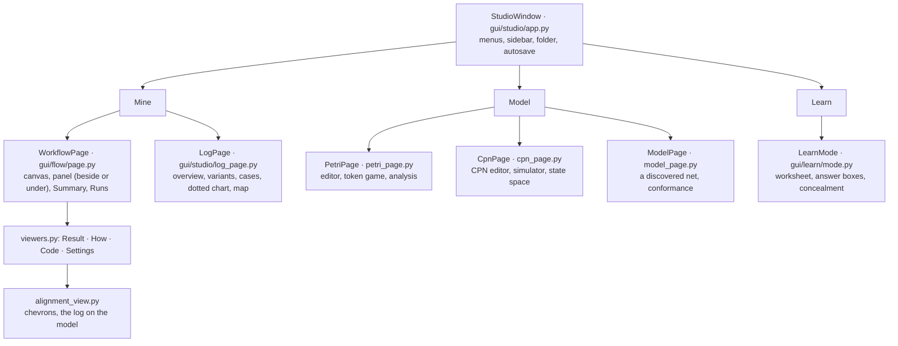

# The code, mapped

A picture of the whole code base, to find your way in it and to check it.
The [design](design.md) says *why* it is built this way, the
[framework specification](framework.md) defines the workflow framework
precisely, and [how-it-works.md](how-it-works.md) goes into the coloured
net engine. This page is the map.

The diagrams marked *generated* are drawn from the code by
`python docs/make_docs.py`; the test suite fails when they no longer match
it, so they cannot go stale between releases.

## Four layers

Every package belongs to one layer and imports only from its own layer and
the ones under it. An engine never imports the framework, and nothing under
the app imports Qt; `docs/make_docs.py --check` fails on an import that
breaks this, so the claim "the engines run in a notebook, the framework runs
in CI" is checked on every change.

| Layer | Packages | Depends on | Who uses it |
|---|---|---|---|
| **Engines** | `mining` (logs, nets, discovery, conformance), `ml`, `model`, `sim`, `analysis`, `io` | the Python standard library only | everything; a script or notebook directly |
| **Framework** | `flow`, `flow.boxes` | the engines | the app, `openprocess run`, a script |
| **Teaching** | `learn` (`teaching` is its old name) | the engines and the framework | Learn mode, `openprocess exercises` |
| **App** | `gui`, `gui.studio`, `gui.flow`, `gui.learn`, `cli` | all of the above, and PySide6 | people |

### The packages and what they import *(generated)*

An arrow means "imports from". Read it bottom-up: the engines at the
bottom import nothing above them.

<!-- generated: package-map -->
```mermaid
flowchart BT
  subgraph engines["Engines · pure Python, no dependencies"]
    mining["<b>mining</b><br/>logs, nets, analysis"]
    mining_discovery["<b>mining.discovery</b><br/>α, Inductive, Heuristics, regions"]
    mining_conformance["<b>mining.conformance</b><br/>replay, alignments, quality"]
    ml["<b>ml</b><br/>CPN ML language"]
    model["<b>model</b><br/>coloured nets"]
    sim["<b>sim</b><br/>CPN simulator"]
    analysis["<b>analysis</b><br/>CPN state space"]
    io["<b>io</b><br/>.cpn files"]
    core["<b>core</b><br/>top level: citation, references, packages"]
  end
  subgraph framework["Framework · workflows of boxes; no Qt"]
    flow["<b>flow</b><br/>boxes, workflows, runner, record"]
    flow_boxes["<b>flow.boxes</b><br/>the standard boxes"]
  end
  subgraph teaching["Teaching · exercise packs and checks; no Qt"]
    learn["<b>learn</b><br/>exercise packs"]
    teaching["<b>teaching</b><br/>old name of learn"]
  end
  subgraph app["App · PySide6"]
    gui["<b>gui</b><br/>net editor, canvas"]
    gui_studio["<b>gui.studio</b><br/>the Studio window and pages"]
    gui_flow["<b>gui.flow</b><br/>the workflow canvas"]
    gui_learn["<b>gui.learn</b><br/>Learn mode"]
    cli["<b>cli</b><br/>the openprocess command"]
  end
  analysis --> io
  analysis --> ml
  analysis --> model
  analysis --> sim
  cli --> analysis
  cli --> flow
  cli --> gui
  cli --> gui_studio
  cli --> io
  cli --> learn
  cli --> mining
  cli --> mining_discovery
  cli --> model
  cli --> sim
  core --> analysis
  core --> io
  core --> ml
  core --> model
  core --> sim
  flow --> core
  flow --> mining
  flow --> mining_conformance
  flow --> model
  flow_boxes --> analysis
  flow_boxes --> flow
  flow_boxes --> io
  flow_boxes --> mining
  flow_boxes --> mining_conformance
  flow_boxes --> mining_discovery
  flow_boxes --> model
  flow_boxes --> sim
  gui --> gui_studio
  gui --> model
  gui_flow --> core
  gui_flow --> flow
  gui_flow --> gui
  gui_flow --> gui_studio
  gui_flow --> mining
  gui_flow --> mining_discovery
  gui_learn --> flow
  gui_learn --> gui_flow
  gui_learn --> gui_studio
  gui_learn --> learn
  gui_learn --> mining
  gui_learn --> model
  gui_studio --> analysis
  gui_studio --> core
  gui_studio --> flow
  gui_studio --> gui
  gui_studio --> gui_flow
  gui_studio --> gui_learn
  gui_studio --> io
  gui_studio --> learn
  gui_studio --> mining
  gui_studio --> mining_conformance
  gui_studio --> mining_discovery
  gui_studio --> ml
  gui_studio --> model
  gui_studio --> sim
  io --> model
  learn --> flow
  learn --> mining
  learn --> mining_conformance
  learn --> mining_discovery
  mining --> mining_conformance
  mining --> mining_discovery
  mining_conformance --> mining
  mining_discovery --> mining
  model --> mining
  model --> ml
  sim --> mining
  sim --> ml
  sim --> model
  teaching --> learn
```
<!-- /generated -->

## A workflow, from the canvas to the record

What happens when you press **Run ▶**, and what each step leaves behind.
The same path runs from `openprocess run` and from a script; only the first
and last boxes differ.

```mermaid
flowchart LR
  subgraph define["Defined"]
    fn["a Python function<br/>with type hints"] -->|"@box reads the signature"| spec["BoxSpec<br/>inputs · outputs · settings"]
    spec --> node["Node on the canvas<br/>settings · position"]
    node --> wf["Workflow<br/>a DAG of nodes and edges"]
  end
  subgraph run["Run"]
    wf -->|"topological order"| key["key = sha256(code + settings + input keys)"]
    key -->|"in the cache?"| cache{{"Cache"}}
    cache -->|"no: call the function"| call["box(**inputs, **settings)<br/>inside explaining()"]
    call --> check["output checked against<br/>the declared type"]
    check --> result["Result<br/>values · status · explanation"]
    cache -->|"yes"| result
  end
  subgraph kept["Kept"]
    result --> fp["fingerprint<br/>(canonical content)"]
    fp --> record[".cpnflow record<br/>inputs · seeds · versions · results"]
    result --> how["How tab<br/>notes · steps · values"]
    spec --> code["Code tab<br/>box + algorithm_calls"]
    record --> badge["Reproducible badge<br/>openprocess run --check"]
  end
```

## The app



## Large logs

A log of a million events is read into columns, not objects
([`mining/columns.py`](../openprocess/mining/columns.py)): one array per
attribute, strings stored once, a case a slice of the arrays. Everything
that has to look at every event reads the arrays: the summary, the cases
table, the dotted chart, the filters (a filtered log stays columnar), the
measuring boxes ([`mining/cases.py`](../openprocess/mining/cases.py)) and the
fingerprint. On the BPI Challenge 2019 log (251,734 cases, 1,595,923
events, 728 MB) reading takes about 12 s and 250 MB, and every log page tab
opens in under 5 s; see [examples/bpi2019](../examples/bpi2019/README.md).

## Every module *(generated)*

<!-- generated: modules -->
### `mining` · logs, nets, analysis

| Module | What it is |
|---|---|
| [`mining/__init__.py`](../openprocess/mining/__init__.py) | Process mining: event logs, discovery, conformance checking. |
| [`mining/analysis.py`](../openprocess/mining/analysis.py) | Behavioural analysis of P/T nets: state spaces, properties, soundness. |
| [`mining/cases.py`](../openprocess/mining/cases.py) | Case by case: what the measuring boxes read from a log, fast on large ones. |
| [`mining/columns.py`](../openprocess/mining/columns.py) | A columnar store for large logs: one array per attribute, no objects. |
| [`mining/compare_nets.py`](../openprocess/mining/compare_nets.py) | Compare two Petri nets on behaviour, not on how they are drawn. |
| [`mining/csv_import.py`](../openprocess/mining/csv_import.py) | Importing event logs from CSV files. |
| [`mining/definitions.py`](../openprocess/mining/definitions.py) | Mathematical definitions of every property the analyses report. |
| [`mining/dfg.py`](../openprocess/mining/dfg.py) | Directly-follows graphs (DFGs) -- the "process map" of tools like Disco. |
| [`mining/filtering.py`](../openprocess/mining/filtering.py) | Filtering event logs: keep the part of the log you want to look at. |
| [`mining/footprint.py`](../openprocess/mining/footprint.py) | Ordering relations and footprint matrices (van der Aalst, ch. 6.2 and 8.4). |
| [`mining/invariants.py`](../openprocess/mining/invariants.py) | The incidence matrix, place invariants and transition invariants. |
| [`mining/layout.py`](../openprocess/mining/layout.py) | Automatic left-to-right layout of process graphs (Sugiyama's method). |
| [`mining/log.py`](../openprocess/mining/log.py) | Event logs: the data every process mining technique starts from. |
| [`mining/ocel.py`](../openprocess/mining/ocel.py) | Object-centric event logs (OCEL): events that touch several objects at once. |
| [`mining/petrinet.py`](../openprocess/mining/petrinet.py) | Place/Transition nets, the model class that discovery produces. |
| [`mining/playout.py`](../openprocess/mining/playout.py) | Play-out: generate an event log by simulating a Petri net. |
| [`mining/pm4py_bridge.py`](../openprocess/mining/pm4py_bridge.py) | Optional bridge to PM4Py for the algorithms not implemented natively. |
| [`mining/pnml.py`](../openprocess/mining/pnml.py) | PNML: the ISO/IEC 15909-2 interchange format for Petri nets. |
| [`mining/processtree.py`](../openprocess/mining/processtree.py) | Process trees: block-structured models that are sound by construction. |
| [`mining/regions.py`](../openprocess/mining/regions.py) | State-based regions: from a transition system to a Petri net. |
| [`mining/stats.py`](../openprocess/mining/stats.py) | Descriptive statistics of an event log. |
| [`mining/structure.py`](../openprocess/mining/structure.py) | Structural properties of WF-nets (van der Aalst, *Workflow Verification*, §3 and §6). |
| [`mining/transition_system.py`](../openprocess/mining/transition_system.py) | Transition systems: the first phase of two-phase discovery. |
| [`mining/xes.py`](../openprocess/mining/xes.py) | Reading and writing XES, the IEEE 1849 standard format for event logs. |

### `mining.discovery` · α, Inductive, Heuristics, regions

| Module | What it is |
|---|---|
| [`mining/discovery/__init__.py`](../openprocess/mining/discovery/__init__.py) |  |
| [`mining/discovery/alpha.py`](../openprocess/mining/discovery/alpha.py) | The α-algorithm (van der Aalst, Weijters & Maruster, 2004). |
| [`mining/discovery/heuristics.py`](../openprocess/mining/discovery/heuristics.py) | Heuristics Miner: frequency-aware dependency graphs (Weijters & van der Aalst). |
| [`mining/discovery/inductive.py`](../openprocess/mining/discovery/inductive.py) | The Inductive Miner (IM) and Inductive Miner – infrequent (IMf). |
| [`mining/discovery/state_regions.py`](../openprocess/mining/discovery/state_regions.py) | Discovery with state-based regions: log → transition system → Petri net. |

### `mining.conformance` · replay, alignments, quality

| Module | What it is |
|---|---|
| [`mining/conformance/__init__.py`](../openprocess/mining/conformance/__init__.py) |  |
| [`mining/conformance/alignments.py`](../openprocess/mining/conformance/alignments.py) | Alignments (Carmona, van Dongen, Solti & Weidlich, ch. 7; course reading 5). |
| [`mining/conformance/quality.py`](../openprocess/mining/conformance/quality.py) | Precision, generalisation and simplicity -- the other three quality dimensions. |
| [`mining/conformance/token_replay.py`](../openprocess/mining/conformance/token_replay.py) | Token-based replay (van der Aalst, *Process Mining*, §8.2). |

### `ml` · CPN ML language

| Module | What it is |
|---|---|
| [`ml/__init__.py`](../openprocess/ml/__init__.py) |  |
| [`ml/ast_nodes.py`](../openprocess/ml/ast_nodes.py) | Abstract syntax tree for the CPN ML subset. |
| [`ml/builtins.py`](../openprocess/ml/builtins.py) | The standard basis available to every inscription. |
| [`ml/colorsets.py`](../openprocess/ml/colorsets.py) | The colour set system: CPN's type system. |
| [`ml/errors.py`](../openprocess/ml/errors.py) | Exception hierarchy for the CPN ML subsystem. |
| [`ml/evaluator.py`](../openprocess/ml/evaluator.py) | The CPN ML evaluator: turns an AST plus an environment into a value. |
| [`ml/lexer.py`](../openprocess/ml/lexer.py) | Tokeniser for the CPN ML subset. |
| [`ml/multiset.py`](../openprocess/ml/multiset.py) | Multiset (bag) algebra -- the arithmetic that CPN markings are made of. |
| [`ml/parser.py`](../openprocess/ml/parser.py) | Recursive-descent parser for the CPN ML subset. |
| [`ml/values.py`](../openprocess/ml/values.py) | Runtime values of the CPN ML subset. |

### `model` · coloured nets

| Module | What it is |
|---|---|
| [`model/__init__.py`](../openprocess/model/__init__.py) |  |
| [`model/declarations.py`](../openprocess/model/declarations.py) | Parsing and compiling a model's declaration block. |
| [`model/examples.py`](../openprocess/model/examples.py) | Small Petri nets to try the editor and the analyses on. |
| [`model/net.py`](../openprocess/model/net.py) | The Coloured Petri Net data model. |
| [`model/plain.py`](../openprocess/model/plain.py) | Plain (uncoloured) Petri nets in the editor. |

### `sim` · CPN simulator

| Module | What it is |
|---|---|
| [`sim/__init__.py`](../openprocess/sim/__init__.py) |  |
| [`sim/binding.py`](../openprocess/sim/binding.py) | Binding search: deciding which transitions can fire, and with what values. |
| [`sim/export.py`](../openprocess/sim/export.py) | A simulation's firing history as an event log. |
| [`sim/simulator.py`](../openprocess/sim/simulator.py) | The simulation engine: firing transitions and advancing the clock. |

### `analysis` · CPN state space

| Module | What it is |
|---|---|
| [`analysis/__init__.py`](../openprocess/analysis/__init__.py) |  |
| [`analysis/state_space.py`](../openprocess/analysis/state_space.py) | State space (reachability graph) generation and analysis. |
| [`analysis/state_space_process.py`](../openprocess/analysis/state_space_process.py) | Compute a state space in a separate process. |

### `io` · .cpn files

| Module | What it is |
|---|---|
| [`io/__init__.py`](../openprocess/io/__init__.py) |  |
| [`io/cpn_reader.py`](../openprocess/io/cpn_reader.py) | Reader for CPN Tools ``.cpn`` files. |
| [`io/cpn_writer.py`](../openprocess/io/cpn_writer.py) | Writer for CPN Tools ``.cpn`` files. |

### `core` · top level: citation, references, packages

| Module | What it is |
|---|---|
| [`__init__.py`](../openprocess/__init__.py) | OpenProcess -- Coloured Petri Nets, Petri nets and process mining, on macOS, Windows and Linux. |
| [`citation.py`](../openprocess/citation.py) | Citations: BibTeX for the app, and for the works each algorithm follows. |
| [`packages.py`](../openprocess/packages.py) | Optional packages, installed from inside the app. |
| [`references.py`](../openprocess/references.py) | Where OpenProcess's notation and algorithms come from. |

### `flow` · boxes, workflows, runner, record

| Module | What it is |
|---|---|
| [`flow/__init__.py`](../openprocess/flow/__init__.py) | Workflows: boxes, their connections, and running them reproducibly. |
| [`flow/box.py`](../openprocess/flow/box.py) | ``@box``: a Python function as a box on the workflow canvas. |
| [`flow/convert.py`](../openprocess/flow/convert.py) | Converters between OpenProcess's types and other libraries' objects. |
| [`flow/datasets.py`](../openprocess/flow/datasets.py) | Public event logs by name, with their fingerprints. |
| [`flow/explain.py`](../openprocess/flow/explain.py) | How a box got to its result: notes, intermediate values and steps. |
| [`flow/figures.py`](../openprocess/flow/figures.py) | The key figure of a result: one number and a line, for a tile or a report. |
| [`flow/history.py`](../openprocess/flow/history.py) | Undo and redo for a workflow, by snapshots. |
| [`flow/library.py`](../openprocess/flow/library.py) | Where boxes come from: OpenProcess's own, a folder's ``boxes/``, and packages. |
| [`flow/provenance.py`](../openprocess/flow/provenance.py) | Where a result came from, carried with it and written into the files it becomes. |
| [`flow/record.py`](../openprocess/flow/record.py) | The ``.cpnflow`` file: a workflow, and the record that makes it reproducible. |
| [`flow/report.py`](../openprocess/flow/report.py) | An analysis as one HTML page: for a supervisor, a reviewer, a hand-in. |
| [`flow/reproducibility.py`](../openprocess/flow/reproducibility.py) | Is this analysis reproducible, right now? One status for the header. |
| [`flow/runner.py`](../openprocess/flow/runner.py) | Running a workflow: in order, only what changed, each box on its own. |
| [`flow/script.py`](../openprocess/flow/script.py) | A workflow as a runnable Python script. |
| [`flow/snapshots.py`](../openprocess/flow/snapshots.py) | Snapshots of an analysis: every finished run, kept, so two can be compared. |
| [`flow/sweep.py`](../openprocess/flow/sweep.py) | Sweeps: run the boxes after a setting once per value. |
| [`flow/types.py`](../openprocess/flow/types.py) | The types boxes exchange. |
| [`flow/workflow.py`](../openprocess/flow/workflow.py) | A workflow: boxes, their settings and the connections between them. |

### `flow.boxes` · the standard boxes

| Module | What it is |
|---|---|
| [`flow/boxes/__init__.py`](../openprocess/flow/boxes/__init__.py) | OpenProcess's own boxes: thin wrappers around the engine, one module per group. |
| [`flow/boxes/check.py`](../openprocess/flow/boxes/check.py) | Check boxes: how well a model fits a log, and what a net is like. |
| [`flow/boxes/compare.py`](../openprocess/flow/boxes/compare.py) | Compare: any number of scores side by side. |
| [`flow/boxes/cpn.py`](../openprocess/flow/boxes/cpn.py) | Coloured net boxes: play a CPN out many times, and compute its state space. |
| [`flow/boxes/discover.py`](../openprocess/flow/boxes/discover.py) | Discover boxes: from a log to a model, each one showing how. |
| [`flow/boxes/filter.py`](../openprocess/flow/boxes/filter.py) | Filter boxes: keep part of a log, as the log viewer's Filter… does. |
| [`flow/boxes/input.py`](../openprocess/flow/boxes/input.py) | Input boxes: what a workflow starts from. |
| [`flow/boxes/measure.py`](../openprocess/flow/boxes/measure.py) | Measure boxes: the questions an audit or a business asks of a real log. |
| [`flow/boxes/output.py`](../openprocess/flow/boxes/output.py) | Output boxes: save a result into the folder, next to the workflow. |
| [`flow/boxes/predict.py`](../openprocess/flow/boxes/predict.py) | Predict boxes: the prediction pipeline of predictive process monitoring. |
| [`flow/boxes/science.py`](../openprocess/flow/boxes/science.py) | Science boxes: how any Python library plugs in. |
| [`flow/boxes/sweeps.py`](../openprocess/flow/boxes/sweeps.py) | Sweep table: the scores of every swept value, stacked. |

### `learn` · exercise packs

| Module | What it is |
|---|---|
| [`learn/__init__.py`](../openprocess/learn/__init__.py) | OpenProcess Learn: exercise packs, their answer boxes, and checking them. |
| [`learn/answers.py`](../openprocess/learn/answers.py) | Reading what a student typed: sets, pairs, traces, numbers. |
| [`learn/checks.py`](../openprocess/learn/checks.py) | Checking answers. |
| [`learn/computed.py`](../openprocess/learn/computed.py) | Computed answers: the right answer worked out from the exercise's own files. |
| [`learn/context.py`](../openprocess/learn/context.py) | What an exercise gives: its files, read once, and the student's variant. |
| [`learn/exam.py`](../openprocess/learn/exam.py) | Exams, points and variants. |
| [`learn/importer.py`](../openprocess/learn/importer.py) | Turning a past exam into a pack: the guided import. |
| [`learn/notation.py`](../openprocess/learn/notation.py) | The notations of the course, read from what a student types and written back. |
| [`learn/pack.py`](../openprocess/learn/pack.py) | Exercise packs: folders of exercises, and the student's progress in them. |
| [`learn/sheet.py`](../openprocess/learn/sheet.py) | An exercise as a worksheet: its question text with answer boxes in it. |

### `teaching` · old name of learn

| Module | What it is |
|---|---|
| [`teaching/__init__.py`](../openprocess/teaching/__init__.py) | The old name of :mod:`openprocess.learn` (``cpnpy.teaching``, CPNpy 0.5): kept so imports keep working. |
| [`teaching/answers.py`](../openprocess/teaching/answers.py) | Moved to :mod:`openprocess.learn.answers`. |
| [`teaching/checks.py`](../openprocess/teaching/checks.py) | Moved to :mod:`openprocess.learn.checks`. |
| [`teaching/pack.py`](../openprocess/teaching/pack.py) | Moved to :mod:`openprocess.learn.pack`. |
| [`teaching/sheet.py`](../openprocess/teaching/sheet.py) | Moved to :mod:`openprocess.learn.sheet`. |

### `gui` · net editor, canvas

| Module | What it is |
|---|---|
| [`gui/__init__.py`](../openprocess/gui/__init__.py) |  |
| [`gui/app.py`](../openprocess/gui/app.py) | The ``openprocess-cpn`` entry point: the CPN editor on its own. |
| [`gui/arc_editing.py`](../openprocess/gui/arc_editing.py) | How arcs are edited on the canvas: the rules of CPN IDE. |
| [`gui/canvas.py`](../openprocess/gui/canvas.py) | The net canvas: the drawing surface and its editing tools. |
| [`gui/items.py`](../openprocess/gui/items.py) | Qt graphics items that draw the net on the canvas. |
| [`gui/panning.py`](../openprocess/gui/panning.py) | An endless canvas: pan anywhere, zoom about the pointer. |
| [`gui/theme.py`](../openprocess/gui/theme.py) | Visual theme: one place that decides what the application looks like. |
| [`gui/tidy.py`](../openprocess/gui/tidy.py) | Making a page of a net neat: snap it to the grid, keeping its layout. |

### `gui.studio` · the Studio window and pages

| Module | What it is |
|---|---|
| [`gui/studio/__init__.py`](../openprocess/gui/studio/__init__.py) | OpenProcess Studio: the process-mining workspace (logs, discovery, conformance). |
| [`gui/studio/__main__.py`](../openprocess/gui/studio/__main__.py) |  |
| [`gui/studio/alignment_view.py`](../openprocess/gui/studio/alignment_view.py) | Alignments drawn as ProM draws them: moves as chevrons, and the log on the model. |
| [`gui/studio/app.py`](../openprocess/gui/studio/app.py) | OpenProcess Studio: the main window, with its three spaces. |
| [`gui/studio/charts.py`](../openprocess/gui/studio/charts.py) | Small painted charts used on the overview page. |
| [`gui/studio/cite.py`](../openprocess/gui/studio/cite.py) | *Cite*: BibTeX for the app and for the works an algorithm follows, to copy. |
| [`gui/studio/command_palette.py`](../openprocess/gui/studio/command_palette.py) | The command palette: one key, type, Enter. |
| [`gui/studio/compare_page.py`](../openprocess/gui/studio/compare_page.py) | Compare two or more event logs side by side. |
| [`gui/studio/connections.py`](../openprocess/gui/studio/connections.py) | The *Connections* view: what flows into OpenProcess, what flows out, and the tools that plug in, drawn as a hub. |
| [`gui/studio/cpn_page.py`](../openprocess/gui/studio/cpn_page.py) | The coloured-Petri-net workspace: edit, simulate and analyse a CPN model. |
| [`gui/studio/definition_view.py`](../openprocess/gui/studio/definition_view.py) | Definitions on screen: hover tooltips, click pop-ups and the reference dialog. |
| [`gui/studio/derivation_view.py`](../openprocess/gui/studio/derivation_view.py) | Typeset derivations: how a discovery algorithm arrived at its model. |
| [`gui/studio/documents.py`](../openprocess/gui/studio/documents.py) | Open documents: the objects the sidebar lists. |
| [`gui/studio/dotted_chart.py`](../openprocess/gui/studio/dotted_chart.py) | The dotted chart, with the configuration and navigation of ProM's plug-in. |
| [`gui/studio/file_dialogs.py`](../openprocess/gui/studio/file_dialogs.py) | Small dialogs about files and folders. |
| [`gui/studio/filter_dialog.py`](../openprocess/gui/studio/filter_dialog.py) | The Filter… dialog of a log page: ProM's and Disco's log filters in one form. |
| [`gui/studio/graph_builders.py`](../openprocess/gui/studio/graph_builders.py) | Turn mining objects into canvas descriptions (:class:`NodeSpec` / :class:`EdgeSpec`). |
| [`gui/studio/graph_view.py`](../openprocess/gui/studio/graph_view.py) | A zoomable canvas for laid-out graphs, and builders for each graph kind. |
| [`gui/studio/instances.py`](../openprocess/gui/studio/instances.py) | The definitions, filled in for the net being analysed. |
| [`gui/studio/log_editor.py`](../openprocess/gui/studio/log_editor.py) | Editing an event log inside the app. |
| [`gui/studio/log_page.py`](../openprocess/gui/studio/log_page.py) | The event log workspace: overview, variants, cases, dotted chart, process map, footprint, and discovery. |
| [`gui/studio/markdown_view.py`](../openprocess/gui/studio/markdown_view.py) | Markdown with maths, as the exercises and the definitions show it. |
| [`gui/studio/mathtext.py`](../openprocess/gui/studio/mathtext.py) | Typeset a small subset of LaTeX maths as Qt rich text (HTML). |
| [`gui/studio/ml_highlighter.py`](../openprocess/gui/studio/ml_highlighter.py) | Syntax highlighting for CPN ML (declarations and inscriptions). |
| [`gui/studio/model_page.py`](../openprocess/gui/studio/model_page.py) | The model workspace: a Petri net with analysis and conformance checking. |
| [`gui/studio/motion.py`](../openprocess/gui/studio/motion.py) | Motion: the few short transitions that make the window read as one flow. |
| [`gui/studio/net_comparison.py`](../openprocess/gui/studio/net_comparison.py) | The result of comparing two nets on behaviour (Compare nets…, and Check in an exercise). |
| [`gui/studio/notes_overlay.py`](../openprocess/gui/studio/notes_overlay.py) | Notes: scratch paper that floats over whatever page is open. |
| [`gui/studio/petri_page.py`](../openprocess/gui/studio/petri_page.py) | The Petri net editor: draw a plain Petri net or WF-net and analyse it. |
| [`gui/studio/provenance.py`](../openprocess/gui/studio/provenance.py) | Where a figure comes from: a *code* link on every card that computes something. |
| [`gui/studio/regions_view.py`](../openprocess/gui/studio/regions_view.py) | Transition systems and their regions on screen. |
| [`gui/studio/sidebar.py`](../openprocess/gui/studio/sidebar.py) | The sidebar's tree: open documents, files not open yet, and subfolders. |
| [`gui/studio/spaces.py`](../openprocess/gui/studio/spaces.py) | The three spaces of the window: Mine, Model and Learn. |
| [`gui/studio/style.py`](../openprocess/gui/studio/style.py) | Design tokens and the stylesheet for the Studio window. |
| [`gui/studio/tool_icons.py`](../openprocess/gui/studio/tool_icons.py) | Icons and mouse cursors for the drawing tools. |
| [`gui/studio/updates.py`](../openprocess/gui/studio/updates.py) | Checking for a newer OpenProcess, and installing it from within the app. |
| [`gui/studio/widgets.py`](../openprocess/gui/studio/widgets.py) | Small reusable widgets: cards, stat tiles, segmented controls, chips. |
| [`gui/studio/workers.py`](../openprocess/gui/studio/workers.py) | Run slow computations off the GUI thread. |
| [`gui/studio/workspace.py`](../openprocess/gui/studio/workspace.py) | Working in a folder such as "Week 2". |

### `gui.flow` · the workflow canvas

| Module | What it is |
|---|---|
| [`gui/flow/__init__.py`](../openprocess/gui/flow/__init__.py) | The Workflows page: the workflow canvas, *+ Add box* and the side panel. |
| [`gui/flow/canvas.py`](../openprocess/gui/flow/canvas.py) | The workflow canvas: boxes, wires, and dragging a wire to connect. |
| [`gui/flow/page.py`](../openprocess/gui/flow/page.py) | The Workflows page: the canvas, *+ Add box*, and a side panel on demand. |
| [`gui/flow/picker.py`](../openprocess/gui/flow/picker.py) | The *+ Add box* popover: every box, a click away, without a panel of its own. |
| [`gui/flow/runs.py`](../openprocess/gui/flow/runs.py) | The *Runs* view of an analysis: its snapshots, two of them compared. |
| [`gui/flow/stepper.py`](../openprocess/gui/flow/stepper.py) | Step through an algorithm: the How tab, one moment at a time. |
| [`gui/flow/summary.py`](../openprocess/gui/flow/summary.py) | The *Summary* of an analysis: the key figure of every box, in one place. |
| [`gui/flow/templates.py`](../openprocess/gui/flow/templates.py) | Ready-made workflows, so a new workflow never opens as an empty canvas. |
| [`gui/flow/viewers.py`](../openprocess/gui/flow/viewers.py) | What the side panel shows for a box: its result, how it got there, its code, and its settings. |

### `gui.learn` · Learn mode

| Module | What it is |
|---|---|
| [`gui/learn/answer_boxes.py`](../openprocess/gui/learn/answer_boxes.py) | The answer boxes of a worksheet (see :mod:`openprocess.learn.sheet`). |
| [`gui/learn/concealment.py`](../openprocess/gui/learn/concealment.py) | Hiding analysis results while you do an exercise. |
| [`gui/learn/mode.py`](../openprocess/gui/learn/mode.py) | OpenProcess Learn: the window for working through an exercise pack. |

### `cli` · the openprocess command

| Module | What it is |
|---|---|
| [`cli.py`](../openprocess/cli.py) | Command-line interface: ``openprocess <command> [options]``. |

167 modules.
<!-- /generated -->
