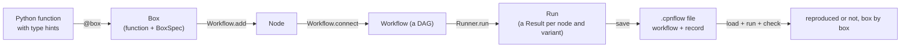
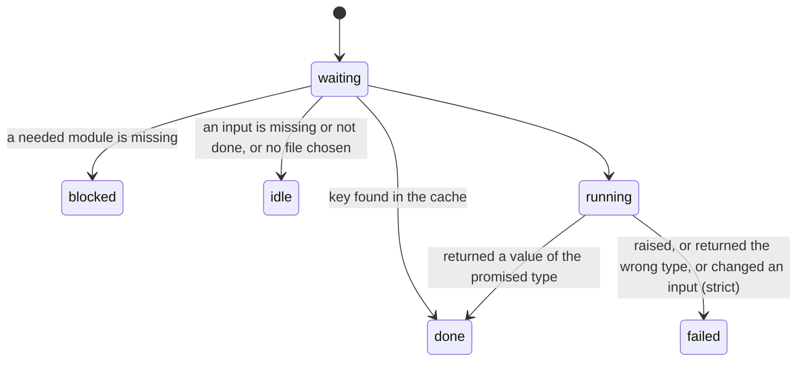

# The OpenProcess workflow framework: specification

This is the precise description of `openprocess.flow`: what a box is, what a
workflow is, what running one does, and what the record of a run promises.
It is written for three readers: a researcher who wants their algorithm on
the canvas, a reviewer who wants to know what a reproduced number means, and
a developer changing the framework. The tutorial is
[workflows.md](workflows.md); the reasons are in [design.md](design.md); the
code map is [architecture.md](architecture.md); every standard box is listed
in [boxes.md](boxes.md).

Where this page and the code disagree, the code is wrong or this page is:
either way it is a bug. The test suite checks that every public name of
`openprocess.flow` is described here.

**Contents.** [1 Overview](#1-overview) · [2 Types](#2-types) ·
[3 Boxes](#3-boxes) · [4 Workflows](#4-workflows) · [5 Running](#5-running) ·
[6 Explanations](#6-explanations) · [7 Fingerprints](#7-fingerprints) ·
[8 The record and the file](#8-the-record-and-the-file) ·
[9 The box contract](#9-the-box-contract) · [10 Extending](#10-extending) ·
[11 The command line](#11-the-command-line) ·
[12 Guarantees](#12-guarantees-and-what-is-not-promised) ·
[13 The public interface](#13-the-public-interface)

---

## 1 Overview



Three objects carry everything:

* a **box** is a function whose signature declares its inputs, outputs and
  settings (§3);
* a **workflow** is a directed acyclic graph of uses of boxes (§4);
* a **run** maps every node (and every sweep variant) to a result, computed
  in a fixed order with caching (§5), and the **record** fingerprints those
  results and everything they depend on (§7, §8).

The framework imports no Qt (checked by `docs/make_docs.py --check`):
everything here runs in a script, a notebook, a test and `openprocess run`
exactly as in the app.

## 2 Types

### 2.1 The registry

Connection points are typed. The registry (`openprocess.flow.types`) maps a
Python class to a `TypeInfo(cls, key, name, colour, python)`: a short `key`
used in files, a plain `name` shown in the app, a colour for the canvas.
`register_type(cls, key, name, colour="#86868b")` adds a class.
`type_info(cls)` finds the entry of `cls` or of its nearest registered base
class (in registration order); `is_known(cls)` is true when there is one, or
for `typing.Any`.

| Key | Class | Name | What it is |
|---|---|---|---|
| `log` | `EventLog` | Log | cases of events with attributes (columnar when large) |
| `simple_log` | `SimpleLog` | Simple log | a multiset of activity sequences |
| `net` | `PetriNet` | Petri net | a labelled P/T net with initial and final marking |
| `cpn` | `CPNet` | Coloured Petri net | a CPN Tools model |
| `marking` | `Marking` | Marking | a multiset of places |
| `tree` | `ProcessTree` | Process tree | |
| `ts` | `TransitionSystem` | Transition system | |
| `dfg` | `DFG` | Directly-follows graph | |
| `ocel` / `ocdfg` | `OCEL` / `OCDFG` | Object-centric log / map | |
| `footprint` | `Footprint` | Footprint | the → ← ‖ # matrix |
| `replay` / `alignments` | `ReplayResult` / `AlignmentResult` | Replay / Alignments | conformance per variant |
| `regions` | `Regions` | Regions | |
| `scores` | `Scores` | Scores | named numbers about one model |
| `table` | `Table` | Table | rows under column names (`samples`: the numbers behind a distribution) |
| `figure` | `Figure` | Figure | SVG text and/or PNG bytes |
| `text` | `Text` | Text | |
| `dataset` / `predictions` / `predictor` | `Dataset` / `Predictions` / `Predictor` | | the prediction pipeline |

`Column` is a `str` subclass used only as a *setting* type (§3.2).

### 2.2 Compatibility

An output of type *S* may feed an input of type *T* when

* *S* = *T*, or *S* is a subclass of *T*; or
* both are `typing.Any` (an "escape hatch": two boxes that agree on a class
  the registry does not know).

At run time a value is also **converted** to the input's type when a
converter exists (§2.3). `Port.accepts(other)` implements the static rule.

### 2.3 Converters

`openprocess.flow.convert` holds functions *f* : *A* → *B*, keyed by the
fully qualified names of *A* and *B*; foreign classes are named by dotted
path, so registering a pandas converter imports nothing. `register(source,
target, function)` adds one; `can_convert(value, target)` and `convert(value,
target)` look one up for the value's class or any base class. Built in:
`SimpleLog ↔ EventLog`, `EventLog ↔ pandas.DataFrame`, `Table ↔ DataFrame`,
`Series → Table`, `ndarray → Table`, `matplotlib Figure → Figure` (with a
fixed SVG id salt and no date, so the same plot gives the same bytes), and
`PetriNet ↔ PM4Py`.

## 3 Boxes

### 3.1 Definition

A **box** is a pair (*f*, *spec*): a Python function *f* and the `BoxSpec`
read from its signature by `make_spec`. `@box(name=…, group=…, needs=…,
heavy=…)` returns a `Box`, which is callable and calls *f* (so a box is still
the function: it runs in a notebook as in the app), with `.spec`.

A `BoxSpec` has an `id` (`module.function`, unique in a library), a `name`,
a `group`, ordered `inputs` and `outputs` (`Port`s), ordered `settings`
(`Setting`s), the docstring as `help` (and `description`: the help without
the setting lines), the `source` and its location, `needs` (modules that must
be importable), and flags `heavy` and `custom`.

### 3.2 From signature to spec

Every parameter must be named (no `*args`, `**kwargs`) and type-hinted, and
the return must be hinted. Each parameter becomes exactly one input or one
setting:

| Parameter annotation | Becomes |
|---|---|
| a registered type *T* (or a subclass) | an input `Port(name, T)` |
| `T \| None`, or a default of `None` | an optional input |
| `list[T]` (or `tuple[T, ...]`) | an input taking any number of connections (`many`); optional when it has a default |
| `typing.Any` | an input of type Any |
| `int`, `float`, `bool`, `str` **with a default** | a setting of that kind, the default its value (`float` defaults are made floats) |
| `Literal["a", "b", …]` | a choice setting (default: as given, else the first) |
| `Column` with a default | a setting naming a column of a connected table |
| `Path` | a file setting (default `None` when not given) |
| anything else | `BoxError`: the message names the parameter and its type |

The return annotation gives the outputs: a registered type *T* gives one
output `out` (optional when `T | None`); a dataclass whose fields are
registered types (or `T | None`, or Any) gives one output per field, in
field order; `None` gives none. A **help line** in the docstring of the form
`name: text` (or the Google style `name (type): text`) is the help of the
setting `name`.

A mistake raises `BoxError` when the module is imported; a library keeps the
file as a `BrokenBox` with the reason (§10).

### 3.3 Settings and their values

`Setting.coerce(value)` turns a value from the app or a file into the
setting's kind: `int` accepts an int, a whole float or a numeric string, and
**rejects** `2.5` rather than rounding it; `float` any number; `bool` a bool
or `1/true/yes/on`; `choice` one of its choices (matched as text); `path` a
`Path` (quotes, shell escapes and `~` undone); `str` and `column` text. A
setting whose default is `None` keeps `None`. A setting value may instead be
a `Sweep` (§5.6).

## 4 Workflows

### 4.1 Structure

A `Workflow` is *W* = (*N*, *E*, *G*, *name*, *library*):

* *N*: nodes by id; a `Node(id, box, settings, position, title, layout)` is
  one use of a box, its `settings` a complete map from the box's settings to
  values (defaults filled in by `add`);
* *E*: edges `Edge(source, output, target, input)`;
* *G*: groups `Group(id, name, members, position)`, each node in at most one.

*W* is **valid** when

1. *E* is acyclic (`order()` raises `WorkflowError` on a loop);
2. every edge joins an existing output to an existing input it is compatible
   with (§2.2);
3. an input that is not `many` has at most one edge;
4. every input that is not optional has an edge, and every box's `needs` are
   installed. `validate()` lists the violations of 4 in plain words; 1–3 are
   refused by `connect` and so cannot arise through the API.

### 4.2 Building

`add(box, settings, position, id, title)` resolves the box in the library
(a `Box`, a `BoxSpec`, an id or a unique function name), coerces the
settings, and gives a fresh id unless one is given. `connect(source, target,
input=None, output="out")` checks with `can_connect` (which also explains a
refusal: "“log” takes a log, not a petri net", "That would make a loop") and
adds the edge; with `input=None` it takes the first compatible input that is
still free (or takes any number), so connecting two logs to a box with
inputs `a` and `b` fills `a`, then `b`. Connecting to a single input that is
already fed replaces its edge. `set(node, **settings)`, `remove`,
`disconnect`, `group`, `ungroup` do what they say.

A **group**'s connection points are derived, not declared: the inputs of its
members fed from outside (or not fed), and the outputs used outside (or not
used). `group_ports(group)` returns them.

### 4.3 As Python

`to_python(wf)` writes *W* as a `@workflow` function (every group a function
of its own, with the imports its types need) and `@workflow` records such a
function back: calling a box inside a recording adds a node and returns a
`Ref` to its output instead of running it. `record(function)` does the
recording; `Recorded.workflow` is the result, drawn in columns by longest
path. A `@workflow` function with typed parameters is also a **composite
box** (`Recorded.as_box()`), recorded as a group. Round trip:
`to_python(record(f))` records to the same nodes, settings and edges.

## 5 Running

`Runner(library, cache, folder, strict).run(workflow, changed=None,
previous=None, stop=None, on_status=None) → Run`.

### 5.1 Order

Nodes run in topological order; among nodes that are ready at the same time,
the one further left (then higher) on the canvas first. The order is
therefore a function of *W* alone.

### 5.2 One box

For a node *n* with box *b* in variant *v*:

1. **Settings.** Its settings, with the variant's swept values put in; a
   relative `path` setting is joined to the runner's `folder`.
2. **Blocked** if `b.needs` are not installed.
3. **Inputs.** For each input port *p*: the values of the edges into *p*
   (one value, or a list when `many`), each from its source's result in the
   same variant (or variant 0 if the source is not swept); converted to
   *p*'s type when needed (§2.3; a failed conversion fails *n* with a message
   naming both boxes). A missing required input, or a source that is not
   done, makes *n* **idle** with the reason ("Waiting for “Inductive Miner”
   (failed)"). A box all of whose inputs are optional and unconnected is idle
   ("Connect scores or tables"), and so is a box whose file setting is empty.
4. **Key.**
   `key(n, v) = sha256(fingerprint(b.source) | json(settings) | key(s₁):o₁ | … | path=size:mtime …)`
   over the inputs' keys in port order, plus, for each file setting, the
   file's size and modification time. Equal keys mean equal code, settings,
   inputs and input files.
5. **Cache.** If the cache holds the key, its values and explanation are
   used (status done, `cached`).
6. **Call.** Otherwise `b.function(**inputs, **settings)` runs inside
   `explaining()` (§6). An exception fails *n*; the error and traceback are
   kept, and the run goes on with the other branches.
7. **Outputs.** The return value is split into outputs (the fields of the
   result dataclass, or `out`) and each is **checked against its declared
   type**: `None` is allowed only for `T | None`; a value of another type is
   converted when possible, else *n* fails ("Alignments returned a dict for
   “out”, but its signature promises an alignments (AlignmentResult)"). A
   `Predictor` output is accepted from any object with `predict`.
8. **Strict.** With `Runner(strict=True)` each input is fingerprinted before
   and after the call, and *n* fails if one changed (§9).
9. **Kept.** The values go into the cache under the key; each value is
   stamped with its **provenance** (workflow, box, title, settings, key,
   OpenProcess version, time; `openprocess.flow.provenance`), which a saved
   SVG, CSV or PNG carries along.

### 5.3 Statuses



`Run.result(node, variant)` is the `Result` (status, `value`, `values` by
output, `error`, `traceback`, `message`, `duration`, `explanation`, `key`,
`cached`); `Run.value(node, output)` the value when done; `Run.ok` is true
when every result is done.

### 5.4 Re-running

`run(wf, changed=[ids], previous=run)` re-runs the given nodes and every
node after them, and copies the other results from `previous`; a different
set of sweep variants re-runs everything. The cache makes a full re-run of
unchanged boxes cheap in any case.

### 5.5 Stopping and heavy boxes

`stop` (a `threading.Event`) is checked between boxes; a stopped run has
`stopped` set. `run_in_process(spec, inputs, settings, timeout)` runs one
standard-library box in a child process that can be killed (for `heavy`
boxes).

### 5.6 Sweeps

A setting whose value is a `Sweep(values)` (`Sweep.parse("0..0.5 step 0.1")`,
`"1..5"`, `"a, b, c"`) varies. With swept settings *s₁ … s_k*, the
**variants** are the cartesian product of their values, in order
(`assignments`). The nodes downstream of a swept node run once per variant;
a node with a `many` input fed from them is a **collector**: it runs once,
with the values of every variant; nodes after a collector run once. Every
`Scores` and `Table` made per variant carries the swept values in its
`context`, so `Table.from_scores` (*Compare*, *Sweep table*) turns them into
columns.

## 6 Explanations

While a box runs, `flow.note(text)`, `flow.show(value, label)` and
`flow.steps(rows)` add to the `Explanation` of that box (a context variable;
outside a box they do nothing, so the function still runs in a script).
`Explanation` keeps `notes`, `shows`, `steps` and all `entries` in order.
After the call, a result with a `steps()` method contributes its rows (if
the box recorded none) and a `warnings` list its notes
(`collect_result`). The app's *How* tab draws the entries; its *Code* tab
shows `b.source` and the source of every function the box calls outside the
framework and the standard library, in call order (`algorithm_calls(spec)`),
so a box's algorithm is readable without the author documenting it twice.

## 7 Fingerprints

`fingerprint(value, scheme=2)` is the SHA-256 of a canonical form of the
value's **content**. It is what the record compares (§8) and what the Runs
tab compares between runs.

### 7.1 Scheme 2 (from 0.12)

`canonical(value)` is defined recursively, giving JSON:

| Value | Canonical form |
|---|---|
| `None`, `bool`, `int`, `str` | itself |
| `float` | rounded to 9 decimals; `nan`/`inf` as text |
| `bytes` | `{"bytes": sha256}` |
| `datetime`, `date`, `time` | ISO 8601 text (with its offset) |
| `timedelta` | `{"seconds": …}` |
| `Path` | POSIX text |
| NumPy array or scalar | its `tolist()` |
| `PetriNet` | `{"type", "name", "places": sorted [id, name], "transitions": sorted [id, name, label], "arcs": sorted [source, target, weight], "initial", "final"}`: drawing (positions, bends, label offsets) and `info` left out |
| a mapping | `{"map": [[k, v], …]}` sorted by the pairs' JSON |
| a set | `{"set": [...]}` sorted by the items' JSON |
| a list or tuple | the list of its items' forms, in order |
| a dataclass | `{"type": class name, field: form, …}` without `provenance`, `position`, `name_offset`, `points`, `info`, `source_path` |
| another object | `{"type", attribute: form, …}` of its public attributes; with none, its `repr` with memory addresses removed |

An `EventLog` is hashed as a stream: the log's attributes, then each case's
attributes and each of its events' attributes, in log order, each as the
canonical form of a mapping. A columnar log is hashed from its arrays and
gives the same digest as the same log read as objects (tested). The record,
the check and the run snapshots ask for a result's fingerprint with
`remember=True`: it is worked out once and kept for as long as the value
lives, since results are not changed after their box returns them (§9).
Anything else, strict mode included, hashes the value as it is now.

Consequences: the order in which a set or a dict was filled never changes a
fingerprint; neither does the session's hash seed, nor where a net is drawn;
a replay or an alignment is fingerprinted by its whole content, not only its
net.

### 7.2 Scheme 1 (up to 0.11)

Kept unchanged to check records written by 0.11 and earlier (§8.2). It hashed
logs by case id, activity and timestamp only, nets as PNML text (so element
order counted), and other objects by `repr` (which follows set order and so
could change between sessions).

## 8 The record and the file

### 8.1 The `.cpnflow` file

```json
{
  "format": "cpnflow/1",
  "name": "…",
  "boxes": [{"id": "n1", "box": "openprocess.flow.boxes.input.open_log", "settings": {"file": "log.xes"},
             "position": [0, 0], "title": "…", "layout": {"p1": [10, 20]}}],
  "connections": [{"from": "n1", "output": "out", "to": "n2", "input": "log"}],
  "groups": [{"id": "g1", "name": "…", "boxes": ["n2", "n3"], "position": [0, 0]}],
  "record": {
    "versions": {"openprocess": "0.12.0", "python": "3.12.4", "numpy": "…"},
    "environment": {"platform": "…", "python": "…", "packages": {"name": "version"}},
    "inputs": [{"node": "n1", "setting": "file", "file": "log.xes", "sha256": "…"}],
    "custom_boxes": [{"file": "boxes/mine.py", "sha256": "…"}],
    "seeds": {"n4": 0},
    "results": {"n2": "<fingerprint>"},
    "fingerprint": 2,
    "saved": "2026-10-23T12:00:00+00:00",
    "history": []
  }
}
```

A swept setting is stored as `{"sweep": [values]}`. File settings and
record paths are relative to the workflow's folder. `save(wf, path, run,
folder, lock, history)` writes atomically (a temporary file, then a rename);
`load(path, library)` reads it. A box id not in the library is replaced by a
folder box with the same function name (a moved or copied folder); a box
that is nowhere is an error naming it.

### 8.2 What is compared

* `differences(record, wf, folder)`: before running, in plain words: an
  input whose SHA-256 changed or that is missing, a box file that changed, a
  seed that changed, another OpenProcess or Python version.
* `check(wf, record, run, complete=False)`: after running, every recorded
  result whose fingerprint (in the record's scheme) differs, or whose box did
  not finish. With `complete=True` (the command line) a recorded box that is
  gone or did not run is a difference too. An empty list is a reproduction.
* `reproducibility.status(wf, record, run, folder)` turns both into the
  badge: *Not recorded*, *Recorded, not run*, *Reproducible*, *n changes
  since*, *Differs from the record*.

### 8.3 Experiments

`export_experiment(wf, run, target, folder)` writes a zip: the workflow and
its record with the inputs moved under `inputs/` (settings rewritten to
match, so it runs where it is unpacked), the inputs, the custom box files,
every result as a file (CSV, PNML, SVG, PNG, XES, text), `requirements.lock`,
`run.py` (the same analysis as a script, `script_text`), `CITATIONS.bib`
and a README. `openprocess run X.cpnflow --check` and `python run.py` work in
the unpacked folder as they are (tested). `import_experiment` unpacks one
into a new folder.

## 9 The box contract

What a box must do for the guarantees of §12 to hold. The framework checks
what it can (marked ✓).

1. **Declare everything it reads.** Inputs as typed parameters, choices as
   settings, files as `Path` settings (✓ fingerprinted in the record; a file
   read any other way is invisible to it), randomness as a `seed` setting
   (✓ recorded).
2. **Return what it promises.** ✓ Checked after every call (§5.2 step 7).
3. **Leave its inputs alone.** Other boxes read the same objects. Copy
   before changing (`copy.deepcopy`, or a filter that builds a new log).
   ✓ Checked with `Runner(strict=True)` / `openprocess run --strict`.
4. **Be deterministic given its declared inputs.** Iterate sets and dicts in
   a fixed order (`sorted(...)`) when the order reaches the result; seed every
   random generator from a setting. The canonical fingerprint forgives the
   order of sets and maps *inside* a result, but not a list built from a
   set's iteration order. ✓ The test suite runs every standard box under
   several hash seeds and compares fingerprints.
5. **Explain itself, cheaply.** `flow.note` for what was decided, `flow.show`
   for an intermediate value, or a result with `steps()`. Nothing is
   required: a box with none of these still has its code on the Code tab.
6. **Stay thin.** A box is a few lines around one engine call; the
   algorithm lives in an engine module that runs without the framework, so the
   Code tab shows it and a notebook can call it.

## 10 Extending

* **A folder's boxes.** Every `.py` file in a folder's `boxes/` (not starting
  with `_`) is loaded by `library_for(folder)` / `Library.load_folder`; the
  boxes it *defines* (and its `@workflow` composites) are registered as
  custom, under their group (default *Yours*). A file that fails becomes a
  `BrokenBox` with the reason; the others load. The app asks once per folder
  before running custom boxes.
* **A package of boxes.** An installed package that declares
  `[project.entry-points."openprocess.boxes"] name = "package.module"` is
  loaded by `Library.load_entry_points`.
* **Types and converters.** `register_type(cls, key, name)`;
  `convert.register(source, target, function)`.
* **Libraries.** `Library` holds specs by id: `get`, `resolve`, `register`,
  `register_module`, `by_group` (in `GROUP_ORDER`), `broken`, `files`.
  `standard_library()` is OpenProcess's own boxes (`STANDARD_MODULES`).

## 11 The command line

`openprocess run FILE.cpnflow` runs a workflow headless (file settings
relative to its folder) and prints every box's status, time and key figure.
Options: `--check` (exit 1 unless every recorded result is reproduced; a
file with no recorded results also exits 1), `--save` (record the results),
`--sweep SETTING=VALUES`, `--strict` (§9.3), `-o FOLDER` (results as files),
`--export FILE.zip` (§8.3), `--report FILE.html` (`report.html_report`),
`--lock` (`requirements.lock`), `-v` (the boxes' notes). `openprocess boxes
[folder]` lists the boxes; `openprocess datasets` the public logs by name.

## 12 Guarantees, and what is not promised

**Guaranteed** (and tested):

* The same workflow, inputs, box code, seeds and OpenProcess version give
  results with the same fingerprints, in any session on the same platform:
  every standard box is deterministic (§9.4) and fingerprints do not depend
  on hash seeds or construction order (§7.1).
* A result is never served from the cache after its code, a setting, an
  input or an input file changed (§5.2 step 4).
* A failure stays in its box: one box failing, or a converter or a wrong
  return type, never stops the run or another branch.
* `--check` passes only when every recorded result was recomputed and
  matched.

**Not promised:**

* The same fingerprints on another OS, Python or package version for boxes
  that use floating-point libraries (SciPy, scikit-learn, matplotlib's text
  layout): compare their values instead. The engines' integer and set
  arithmetic is not affected.
* Anything a custom box reads that it did not declare (§9.1).
* Speed: the record says what was computed, not how fast.

## 13 The public interface

The names exported by `openprocess.flow`, each described above; the 1.0
freeze is planned to cover them, the `.cpnflow` format and the command line
(see "Open decisions" in [design.md](design.md)):

`box`, `Box`, `BoxError`, `BoxSpec`, `Port`, `Setting` (§3);
`Workflow`, `WorkflowError`, `Node`, `Edge`, `Group`, `workflow`, `to_python` (§4);
`Runner`, `Run`, `Result`, `Cache`, `Sweep` (§5);
`Explanation`, `current`, `note`, `show`, `steps` (§6);
`save`, `load`, `check`, `differences` (§8);
`Library`, `library_for`, `standard_library` (§10);
`register_type` and the types `Any`, `AlignmentResult`, `CPNet`, `Column`, `DFG`, `Dataset`, `EventLog`,
`Figure`, `Footprint`, `Marking`, `PetriNet`, `Predictions`, `Predictor`, `ProcessTree`, `Regions`,
`ReplayResult`, `Scores`, `SimpleLog`, `Table`, `Text`, `TransitionSystem` (§2).
